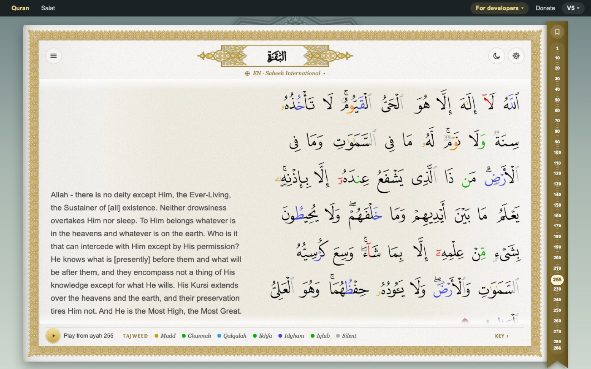
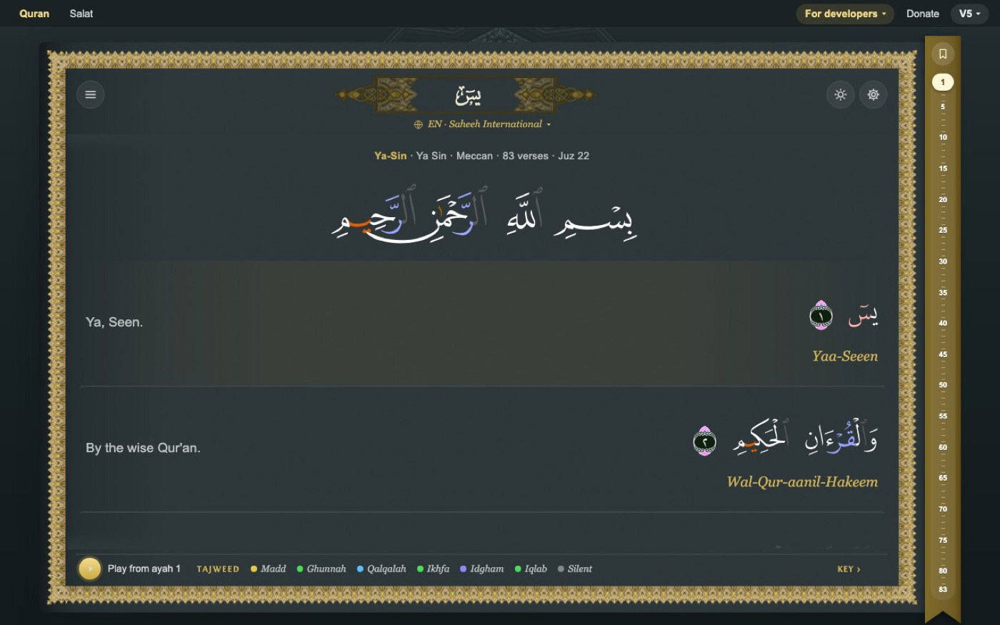
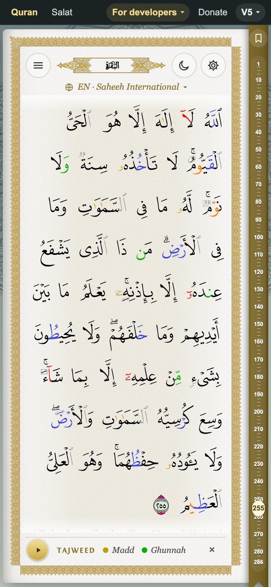
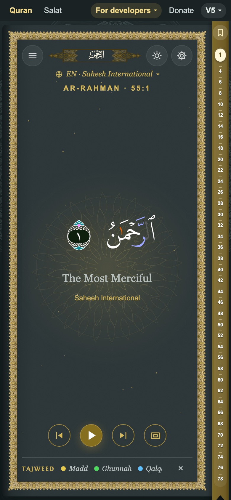

<div align="center">

# Quran Anywhere

**A complete, beautiful Quran reader you can put on any website or app in about a minute.**<br>
Copy two lines of HTML. No account, no API key, no build, no server.

[**Live demo**](https://globalquran.com) · [Embed demo](embed-demo.html) · [Quick start](#quick-start-in-a-minute) · [API docs](https://docs.globalquran.com) · [Open Quran data](https://github.com/GlobalQuran/data)

<sub>by <a href="https://globalquran.com">Global Quran</a> · free and open source</sub>

<br>



</div>

<table>
<tr>
<td width="33%" align="center"><br><sub><b>Night theme</b> · verse by verse, with translation</sub></td>
<td width="33%" align="center"><br><sub><b>Phone</b> · flowing mushaf page</sub></td>
<td width="33%" align="center"><br><sub><b>Listen</b> · one verse at a time, recited</sub></td>
</tr>
</table>

---

## Quick start (in a minute)

Pick the one that fits. **Option 1 needs nothing but a web page.**

### 1. Embed it: 30 seconds, nothing to install

Paste this where you want the Quran to appear (a blog post, a mosque site, a school portal, a WordPress "Custom HTML" block, a Notion embed, a WebView in your app):

```html
<div class="globalquran-book" data-surah="36" data-height="720"></div>
<script src="https://globalquran.com/embed.js" async></script>
```

That is the whole thing. It opens Surah Ya-Sin, in a frame that fits your page, with audio, translations and tajweed colours already working. Change `data-surah` to any number from 1 to 114, add `data-ayah="255"` to land on a verse, `data-theme="night"` for a dark look, or `data-translation="fr.hamidullah"` for another language. [All options below](#embed-options).

> The frame is an iframe, so your site's CSS and JavaScript cannot break the reader and it cannot break yours.

### 2. Run it on your computer: 1 minute

```bash
git clone https://github.com/GlobalQuran/quran-anywhere.git
cd quran-anywhere
python3 -m http.server 8765      # or: make start
```

Open http://localhost:8765. That's the whole install: it is just a folder of static files.

### 3. Publish your own copy: 2 minutes

Upload the folder to **any** static host and you have your own Quran website at your own address: GitHub Pages, Netlify, Cloudflare Pages, Vercel, S3, nginx, Apache or plain shared hosting. No build command. Put it in a sub-folder (`yoursite.com/quran/`) if you like; links are relative. Then point your embeds at your copy: `<script src="https://YOUR-HOST/embed.js" async></script>`.

---

## Why Quran Anywhere

Most Quran projects hand you an API and leave the hard part to you: page layout, fonts, audio, tajweed, translations, accessibility, phones. Quran Anywhere is the finished reader. Your visitors get a complete Quran experience on day one, and you write nothing.

- **No build, no framework, no database.** Plain HTML, CSS and JavaScript you can read and edit.
- **Nothing to sign up for.** Text, 95 translations, word data and recitation audio come from the free Global Quran API and CDN.
- **Looks right on every screen.** Phones, tablets, desktops; day and night; large text; right-to-left aware.
- **Safe to embed.** Runs in its own frame; no tracking, no ads, no cookies of yours touched.
- **Yours to change.** Fork it, restyle it, host it anywhere.

## Embed options

Every option is an attribute on the `div`. All are optional. See [`embed-demo.html`](embed-demo.html) for a full example on a sample blog: inline, on a dark section, and controlled from the page's own buttons.

| Attribute | Values |
|---|---|
| `data-surah`, `data-ayah` | where to open |
| `data-height` | pixels, default `720` |
| `data-sidebar` | `1` shows the surah list (needs 1100px+) |
| `data-translation` | any translation id (`en.sahih`, `fr.hamidullah`, `ur.jalandhry`…), several with commas, or `none` |
| `data-theme` | `day`, `night`, `auto` |
| `data-accent` | hex colour, no `#` |
| `data-player` | `0` hides the audio player |
| `data-font` | `mushaf`, `amiri`, `me` |
| `data-api-key`, `data-api-url` | your API key (optional), another API address |

**Control it from your page:**

```js
const book = document.querySelector(".globalquran-book").globalquran;
book.goto(36, 12);
book.setTheme("night");
book.setTranslation("en.sahih");
book.play(5);
book.pause();
```

Listen for `globalquran:ready` and `globalquran:ayah` (`event.detail.surah`, `event.detail.ayah`).

## Features

- **Reading modes:** verse by verse, a flowing Reading view, a one-verse-at-a-time **Listen** view (with focus and full screen), saved verses.
- **Mushaf text with tajweed colours** (with a colour key), plus Amiri Quran and other Arabic fonts, and calligraphic surah titles.
- **95 translations, any number at once,** plus transliteration and word-by-word meanings.
- **Audio that keeps going:** pick a reciter and a translation voice, set speed and repeat, and it plays on from surah to surah through to the end of the Quran. Tap any verse number to play from there. Eye button flips between Listen and reading views.
- **Day / night / system theme,** text size, and it remembers where you were. The browser tab title always shows the verse (`2:255 Al-Baqarah`).
- **Links that work everywhere:** `#2:255` on any host, or clean `/2:255` paths where you can rewrite URLs.
- **Accessible:** keyboard shortcuts (press `?`), screen-reader labels, reduced-motion and high-contrast support, WCAG AA contrast.

## Settings

Set these in a `<script>` **before** `app.js` (or pass them as `?query` parameters where noted). Everything is optional.

| Setting | What it does |
|---|---|
| `window.GQ_URLS = "hash" \| "path" \| "off"` | How the place is written in the address bar. `hash` (`#2:255`) works on any host and is the default. `path` (`/2:255`) needs the host to serve `index.html` for every path (see below). `off` leaves the address alone. Also `?urls=` or `<meta name="gq-urls" content="path">`. |
| `window.GQ_BASE = "/quran/"` | Folder the app lives in, for path links. Worked out automatically if not set. |
| `window.GQ_TRANSLATIONS = "en.sahih,ur.jalandhry"` | Default translations for a visitor's **first** visit (their own choice wins afterwards). |
| `window.GQ_API_KEY = "…"` | Your API key, if you have one (`?key=`). The API answers without one today. |
| `window.GQ_API_URL = "…"` | Use another API base (`?api=`). |
| `window.GQ_ASSETS = "…"` | Where mushaf glyph data and page fonts load from (default: the Global Quran CDN). |

Other query parameters: `?theme=night`, `?tr=en.sahih`, `?font=amiri`, `?player=0`, `?sidebar=1`. Embeds and `?embed=1` never touch the address bar.

<details>
<summary><strong>Clean <code>/2:255</code> links (optional)</strong></summary>

Make your server return `index.html` for unknown paths, then set `window.GQ_URLS = "path"`.

```nginx
# nginx
location / { try_files $uri $uri/ /index.html; }
```

```apache
# .htaccess (Apache)
RewriteEngine On
RewriteCond %{REQUEST_FILENAME} !-f
RewriteCond %{REQUEST_FILENAME} !-d
RewriteRule ^ index.html [L]
```

Netlify / Cloudflare Pages: a `_redirects` file with `/*  /index.html  200`. Links are relative, so the app works at the root or in a sub-folder.

</details>

<details>
<summary><strong>Upgrading from the older GlobalQuran <code>site</code> code</strong></summary>

This repository used to be `GlobalQuran/site`; old links redirect here. If you ran the earlier `upload` / `app.settings.js` version, your settings are still read: `url.html5` picks path or hash links, `url.enable` turns addresses off, `url.startWith` sets the folder, and your `gq.quran.add("…")` calls become the default translations (ids that no longer exist are ignored). The old `upload-auto` PHP proxy keeps working when it points at a host that supports it. Old GlobalQuran links (`/37`, `/quran-uthmani+en.sahih/2:255`, `?surah=2&ayah=255`) keep working too.

</details>

## Where the data comes from

| What | Source |
|---|---|
| Translations, reciters, text | the free [Global Quran API](https://docs.globalquran.com) (`gq-api.js`, cached in the browser) |
| Audio | `audio.globalquran.com` (many reciters, several qualities) |
| Mushaf glyphs and page fonts | `audio.globalquran.com` (built from [Quran.com](https://quran.com)'s resources, which they allow developers to use) |
| Surah names, counts, juz | `data/surahs.json` (a tiny local copy for the first paint, refreshed from the API) |

The Quran text and translations are open data: [GlobalQuran/data](https://github.com/GlobalQuran/data).

## How it's built

```
index.html   page shell and every dialog
app.css      all styling (day and night)
app.js       the reader
gq-api.js    API client (caching, errors)
embed.js     the two-line embed
data/        small local data (surah list, page table)
fonts/ img/  fonts, frame, icons
docs/        screenshots used in this README
```

Edit a file, refresh the browser. When you change `app.css` or `app.js`, bump the `?v=` on its `<script>` / `<link>` in `index.html` so browsers fetch the new copy.

## Privacy

No ads, no tracking by default. Anonymous usage statistics run **only on globalquran.com**, ask first where the law requires it, never run inside an embed, and are off on every other host unless you turn them on.

## Using Quran Anywhere?

Tell us! Open an issue with a link to your site or app and we'll add it to a showcase. Seeing where the Quran is being read is the best motivation for everyone who works on this.

## Contributing

Bug reports, interface translations, accessibility fixes and pull requests are welcome. Please test on a phone-sized screen and in both day and night themes before sending a change.

## Credits and licence

- Mushaf page fonts and word data: [Quran.com](https://quran.com). Arabic fonts: Amiri Quran, KFGQPC Naskh, Me Quran. Surah title font and ornaments: Global Quran.
- The code is released under the **Simple Public License 2.0**, as in earlier releases; fonts and data keep their own licences.

<div align="center">

بسم الله الرحمن الرحيم

If this helps you, share it, and make a du'a for everyone who worked on it.

</div>
